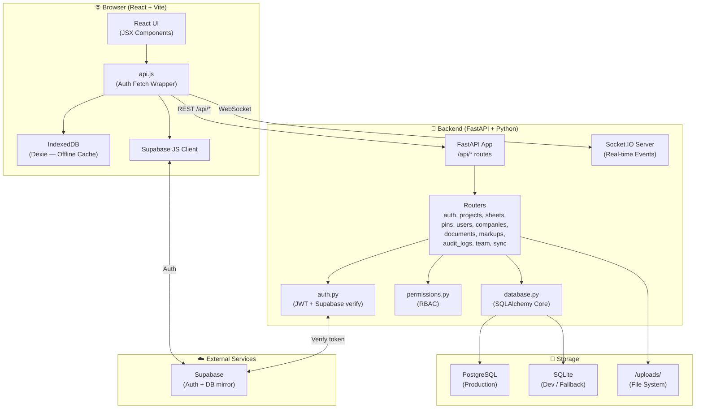
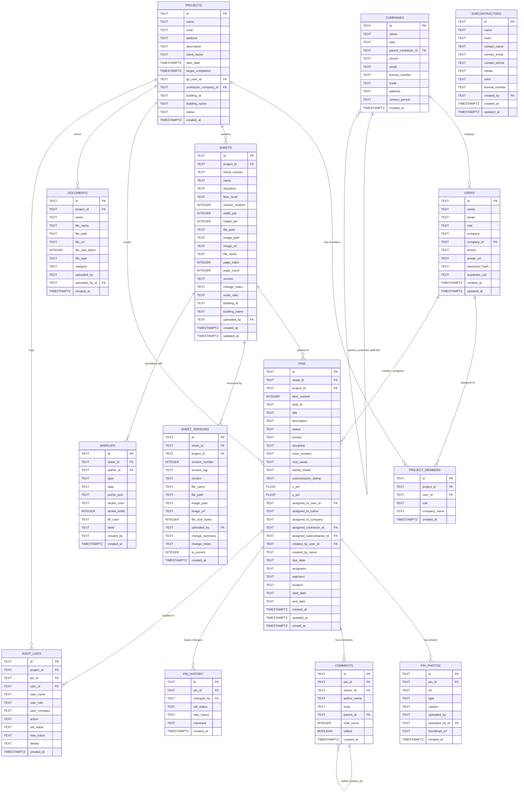
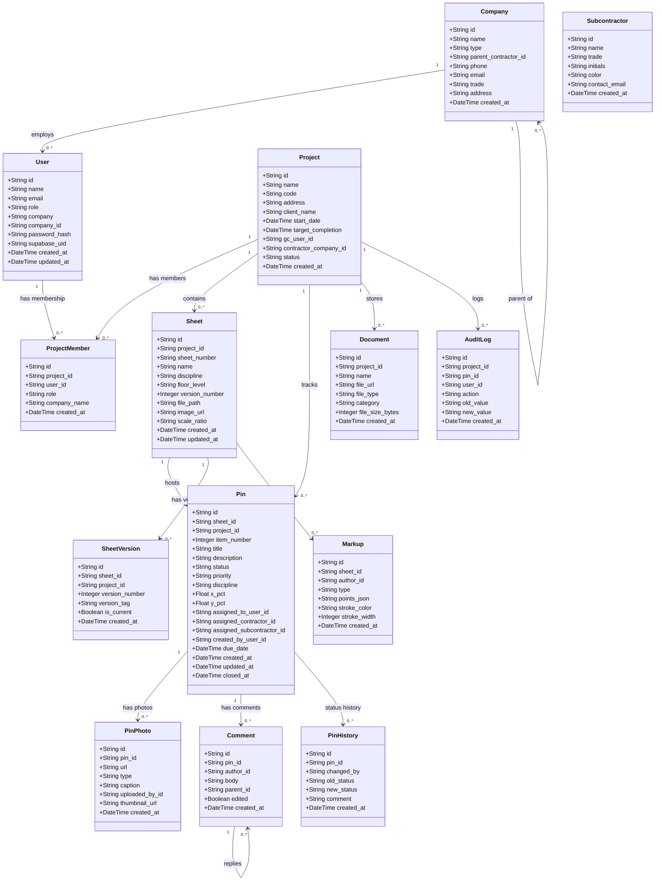
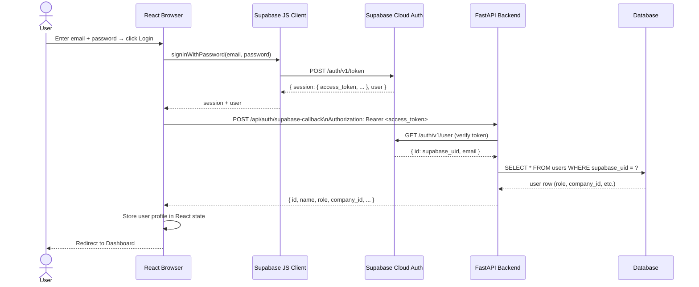
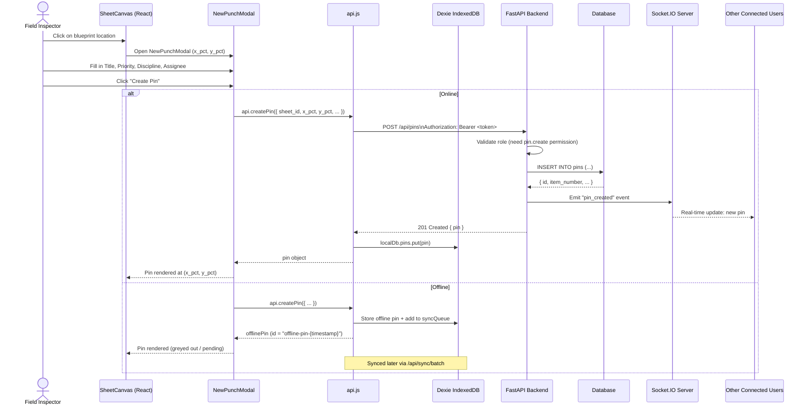
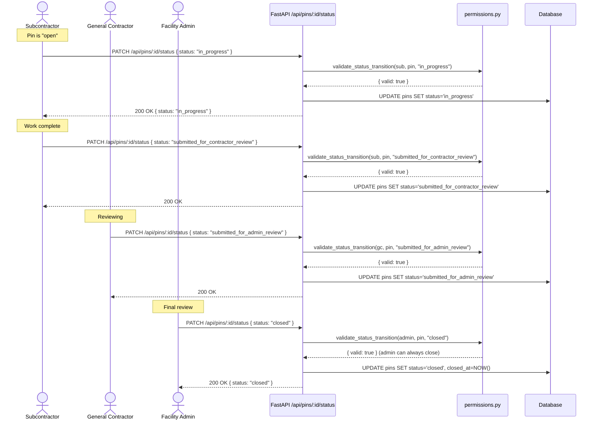
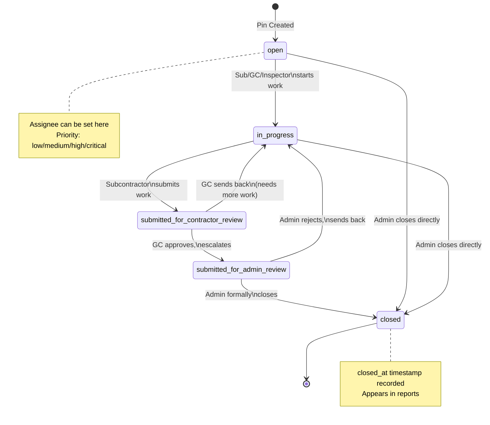
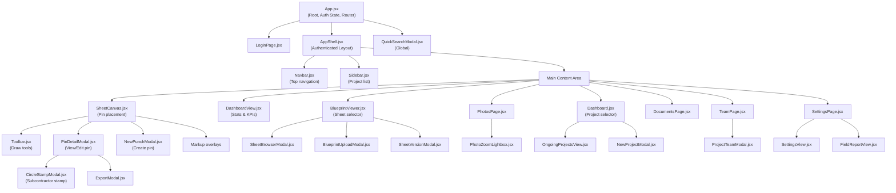
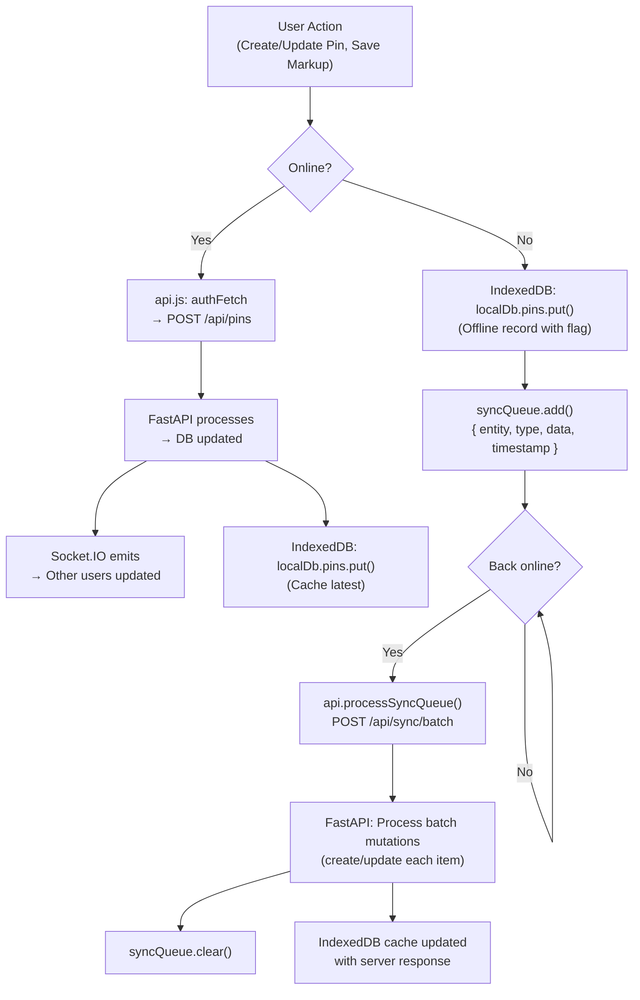

# PunchList Pro — Complete Diagrams Reference
> **Starting from scratch?** This document gives you every diagram you need to understand, design, and build PunchList Pro before writing a single line of code.

---

## Table of Contents
1. [System Overview](#1-system-overview--component-diagram)
2. [ER Diagram — Database](#2-er-diagram--database-schema)
3. [UML Class Diagram — Backend Models](#3-uml-class-diagram--backend-domain-models)
4. [UML Use Case Diagram — Roles & Permissions](#4-uml-use-case-diagram--roles--permissions)
5. [UML Sequence Diagram — Login Flow](#5-uml-sequence-diagram--login-flow)
6. [UML Sequence Diagram — Create a Pin (Punch Item)](#6-uml-sequence-diagram--create-a-pin-punch-item)
7. [UML Sequence Diagram — Status Workflow](#7-uml-sequence-diagram--pin-status-workflow)
8. [UML State Machine — Pin Lifecycle](#8-uml-state-machine--pin-lifecycle)
9. [Frontend Component Tree (UML Package Diagram)](#9-frontend-component-tree)
10. [Data Flow Diagram — Offline Sync](#10-data-flow-diagram--offline-sync)

---

## 1. System Overview — Component Diagram

---

## 2. ER Diagram — Database Schema

> **Legend:** PK = Primary Key, FK = Foreign Key, `||--o{` = one-to-many, `||--||` = one-to-one, `}o--o{` = many-to-many (via junction table)

---

## 3. UML Class Diagram — Backend Domain Models

---

## 4. UML Use Case Diagram — Roles & Permissions

```mermaid
graph LR
    ADMIN(["👤 Admin\n(Facility Admin)"])
    GC(["👤 General\nContractor"])
    SUB(["👤 Sub\nContractor"])
    ARCH(["👤 Architect"])
    OWNER(["👤 Owner"])
    FI(["👤 Field\nInspector"])

    subgraph Auth["🔐 Authentication"]
        UC_LOGIN["Login"]
        UC_LOGOUT["Logout"]
    end

    subgraph Projects["📁 Projects"]
        UC_VIEW_PROJ["View Projects"]
        UC_CREATE_PROJ["Create Project"]
        UC_UPDATE_PROJ["Update Project"]
        UC_MANAGE_TEAM["Manage Team"]
        UC_MANAGE_COMPANY["Manage Companies"]
    end

    subgraph Sheets["📐 Sheets / Blueprints"]
        UC_VIEW_SHEET["View Sheets"]
        UC_MANAGE_SHEET["Upload / Manage Sheets"]
        UC_MARKUP["Add Markups"]
    end

    subgraph Pins["📌 Punch Items (Pins)"]
        UC_VIEW_PIN["View Pins"]
        UC_CREATE_PIN["Create Pin"]
        UC_UPDATE_PIN["Update Pin"]
        UC_ASSIGN_PIN["Assign Pin"]
        UC_CLOSE_PIN["Close / Delete Pin"]
        UC_UPDATE_OWN_PIN["Update Own Assigned Pin"]
        UC_COMMENT["Add Comment"]
        UC_PHOTO["Upload Photo"]
    end

    subgraph Reports["📊 Reports"]
        UC_EXPORT["Export Reports"]
    end

    ADMIN --> UC_LOGIN
    GC --> UC_LOGIN
    SUB --> UC_LOGIN
    ARCH --> UC_LOGIN
    OWNER --> UC_LOGIN
    FI --> UC_LOGIN

    ADMIN --> UC_VIEW_PROJ
    ADMIN --> UC_CREATE_PROJ
    ADMIN --> UC_UPDATE_PROJ
    ADMIN --> UC_MANAGE_TEAM
    ADMIN --> UC_MANAGE_COMPANY
    ADMIN --> UC_VIEW_SHEET
    ADMIN --> UC_MANAGE_SHEET
    ADMIN --> UC_MARKUP
    ADMIN --> UC_VIEW_PIN
    ADMIN --> UC_CREATE_PIN
    ADMIN --> UC_UPDATE_PIN
    ADMIN --> UC_ASSIGN_PIN
    ADMIN --> UC_CLOSE_PIN
    ADMIN --> UC_COMMENT
    ADMIN --> UC_PHOTO
    ADMIN --> UC_EXPORT

    GC --> UC_VIEW_PROJ
    GC --> UC_UPDATE_PROJ
    GC --> UC_MANAGE_TEAM
    GC --> UC_MANAGE_COMPANY
    GC --> UC_VIEW_SHEET
    GC --> UC_MANAGE_SHEET
    GC --> UC_MARKUP
    GC --> UC_VIEW_PIN
    GC --> UC_CREATE_PIN
    GC --> UC_UPDATE_PIN
    GC --> UC_ASSIGN_PIN
    GC --> UC_COMMENT
    GC --> UC_PHOTO
    GC --> UC_EXPORT

    SUB --> UC_VIEW_PROJ
    SUB --> UC_VIEW_SHEET
    SUB --> UC_VIEW_PIN
    SUB --> UC_UPDATE_OWN_PIN
    SUB --> UC_COMMENT
    SUB --> UC_PHOTO

    ARCH --> UC_VIEW_PROJ
    ARCH --> UC_VIEW_SHEET
    ARCH --> UC_MARKUP
    ARCH --> UC_VIEW_PIN
    ARCH --> UC_CREATE_PIN
    ARCH --> UC_UPDATE_PIN
    ARCH --> UC_COMMENT
    ARCH --> UC_PHOTO
    ARCH --> UC_EXPORT

    OWNER --> UC_VIEW_PROJ
    OWNER --> UC_VIEW_SHEET
    OWNER --> UC_VIEW_PIN
    OWNER --> UC_COMMENT
    OWNER --> UC_EXPORT

    FI --> UC_VIEW_PROJ
    FI --> UC_VIEW_SHEET
    FI --> UC_VIEW_PIN
    FI --> UC_CREATE_PIN
    FI --> UC_UPDATE_PIN
    FI --> UC_COMMENT
    FI --> UC_PHOTO
```

---

## 5. UML Sequence Diagram — Login Flow

> **Fallback**: If Supabase is unavailable, the browser falls back to `POST /api/auth/login` using bcrypt password check against the local `users` table, and receives a local JWT token.

---

## 6. UML Sequence Diagram — Create a Pin (Punch Item)

---

## 7. UML Sequence Diagram — Pin Status Workflow

---

## 8. UML State Machine — Pin Lifecycle

---

## 9. Frontend Component Tree

---

## 10. Data Flow Diagram — Offline Sync

---

## Quick Reference: API Endpoints

| Method | Endpoint | Description | Min Role |
|--------|----------|-------------|----------|
| POST | `/api/auth/login` | Local JWT login | — |
| POST | `/api/auth/supabase-callback` | Exchange Supabase token | — |
| GET | `/api/auth/me` | Current user profile | Any |
| GET | `/api/projects` | List all projects | Any |
| POST | `/api/projects` | Create project | Admin |
| PATCH | `/api/projects/:id/status` | Update project status | GC+ |
| GET | `/api/projects/:id/members` | Get project team | Any |
| POST | `/api/projects/:id/members` | Add team member | GC+ |
| GET | `/api/projects/:id/sheets` | List sheets | Any |
| POST | `/api/projects/:id/sheets/upload` | Upload PDF drawing set | GC+ |
| GET | `/api/sheets/:id/versions` | Version history | Any |
| POST | `/api/sheets/:id/versions` | Upload new version | GC+ |
| GET | `/api/sheets/:id/pins` | Pins on a sheet | Any |
| GET | `/api/projects/:id/pins` | All pins for project | Any |
| POST | `/api/pins` | Create punch item | FI+ |
| PUT | `/api/pins/:id` | Update punch item | FI+ |
| PATCH | `/api/pins/:id/status` | Change pin status | Role-gated |
| POST | `/api/pins/:id/assign` | Assign pin | GC+ |
| DELETE | `/api/pins/:id` | Delete pin | Admin |
| POST | `/api/pins/:id/photos` | Upload photo | FI+ |
| POST | `/api/pins/:id/comments` | Add comment | Any |
| GET | `/api/sheets/:id/markups` | Get markups | Any |
| POST | `/api/sheets/:id/markups` | Save markup | Any |
| GET | `/api/companies` | List companies | Any |
| POST | `/api/companies` | Create company | Admin/GC |
| GET | `/api/team` | All users | Admin/GC |
| POST | `/api/team` | Add user | Admin |
| GET | `/api/documents` | List documents | Any |
| POST | `/api/documents/upload` | Upload document | GC+ |
| POST | `/api/sync/batch` | Sync offline queue | Any |
| GET | `/api/audit-logs` | Audit log | Admin |

---

## Role Permissions Summary

| Permission | Admin | GC | Sub | Architect | Owner | Inspector |
|-----------|-------|----|-----|-----------|-------|-----------|
| project.view | ✅ | ✅ | ✅ | ✅ | ✅ | ✅ |
| project.create | ✅ | ❌ | ❌ | ❌ | ❌ | ❌ |
| project.update | ✅ | ✅ | ❌ | ❌ | ❌ | ❌ |
| team.manage | ✅ | ✅ | ❌ | ❌ | ❌ | ❌ |
| company.manage | ✅ | ✅ | ❌ | ❌ | ❌ | ❌ |
| sheet.view | ✅ | ✅ | ✅ | ✅ | ✅ | ✅ |
| sheet.manage | ✅ | ✅ | ❌ | ❌ | ❌ | ❌ |
| pin.view | ✅ | ✅ | ✅ | ✅ | ✅ | ✅ |
| pin.create | ✅ | ✅ | ❌ | ✅ | ❌ | ✅ |
| pin.update | ✅ | ✅ | ❌ | ✅ | ❌ | ✅ |
| pin.update.assigned | ✅ | ✅ | ✅ | ✅ | ❌ | ✅ |
| pin.assign | ✅ | ✅ | ❌ | ❌ | ❌ | ❌ |
| pin.delete | ✅ | ❌ | ❌ | ❌ | ❌ | ❌ |
| pin.close | ✅ | ❌ | ❌ | ❌ | ❌ | ❌ |
| comment.create | ✅ | ✅ | ✅ | ✅ | ✅ | ✅ |
| photo.create | ✅ | ✅ | ✅ | ✅ | ❌ | ✅ |
| report.export | ✅ | ✅ | ❌ | ✅ | ✅ | ❌ |
| task.manage | ✅ | ✅ | ❌ | ❌ | ❌ | ❌ |
