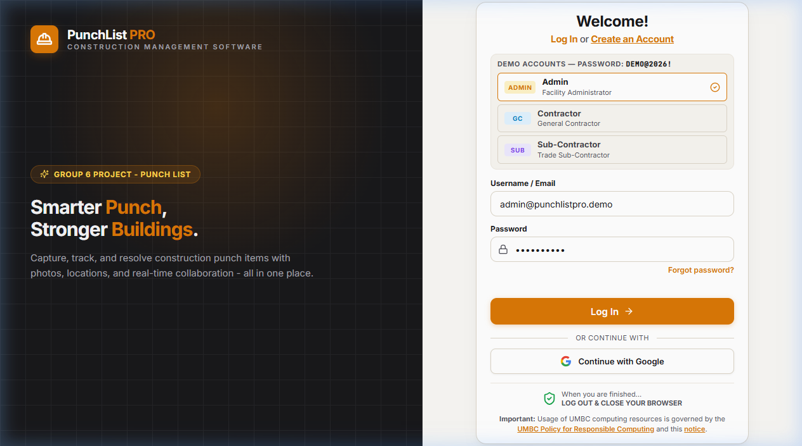

# PunchList Pro — Frontend

Welcome to the frontend of **PunchList Pro** (CMSC 447 — Group 6 Project). This client application is built with React, Vite, and custom Vanilla CSS design tokens.

---

## 📸 Login Page Preview

---

## 🚀 Login Page Features & Enhancements

Here is a summary of the authentication and login interface recently introduced:

### 1. 🎨 Dual-Panel Modern Design
- **Left Hero Panel**:
  - Deep Charcoal background (`#18181B`) with warm amber radial glow (`#D97706`).
  - Subtle CAD / Blueprint grid overlay symbolizing architectural and engineering precision.
  - PunchList Pro hardhat branding and Group 6 project identification badge.
- **Right Login Card**:
  - Clean card surface with soft elevation, rounded corners, and clear visual hierarchy.

---

### 2. 🏛️ UMBC Compliance & Institutional Integration
- **Account Creation**: Direct header link to [UMBC Account Services](https://accounts.umbc.edu/) ("Log In or Create an Account").
- **UMBC Responsible Computing Notice**: Integrated legal compliance notice with verified outbound links:
  - [UMBC Policy for Responsible Computing](https://my.umbc.edu/go/responsible-computing)
  - [UMBC MOTD Notice](https://webauth.umbc.edu/motd.html)
- **Session Security Reminder**: Standard institutional security warning reminding users to log out and close their browser after shared terminal usage.

---

### 3. ⚡ One-Click Demo Role Switcher
Convenient demo profile selectors for quick grading, testing, and walkthroughs:
- **Admin**: Facility Administrator (`admin@punchlistpro.demo`)
- **GC**: General Contractor (`contractor@punchlistpro.demo`)
- **SUB**: Trade Sub-Contractor (`sub@punchlistpro.demo`)
- Automatically populates credentials with active role card highlighting.

---

### 4. 📐 Precision Form Ergonomics & Alignment
- **Left-Aligned Inputs**: Username / Email field with clear labels and placeholder text.
- **Password Input & Recovery**: Secure masked password field with lock icon and correctly positioned "Forgot password?" link directly underneath the password input container.
- **Action Buttons**: High-contrast, accessible Amber "Log In →" primary button with hover micro-animations.

---

### 5. 🔑 Single Sign-On (SSO) & Backend Authentication
- **Google OAuth**: Integrated "Continue with Google" button utilizing Supabase Auth.
- **Resilient Fallback**: Graceful offline / demo fallback credentials validation when backend services are offline.

---

### 6. 📱 Responsive Tablet & Mobile Layout
- Fully responsive across desktop, tablet landscape (1024px+ / 820px), and tablet portrait (768px).
- On tablet portrait and mobile screens, the hero panel smoothly condenses into a centered, clean brand header and full-width card, ensuring seamless field usability on iPads and Surface tablets on-site.

---

## 🛠️ Tech Stack (Frontend)
- **Framework**: React 18
- **Bundler**: Vite
- **Styling**: Vanilla CSS with comprehensive design token variables (`theme.css`)
- **Authentication**: Supabase Auth & REST API client
- **Icons**: Lucide React
